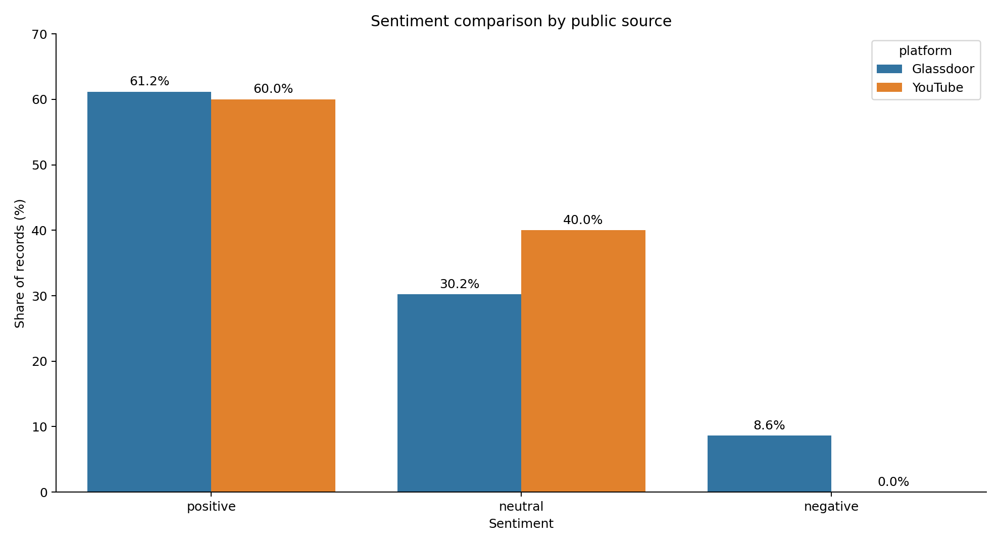
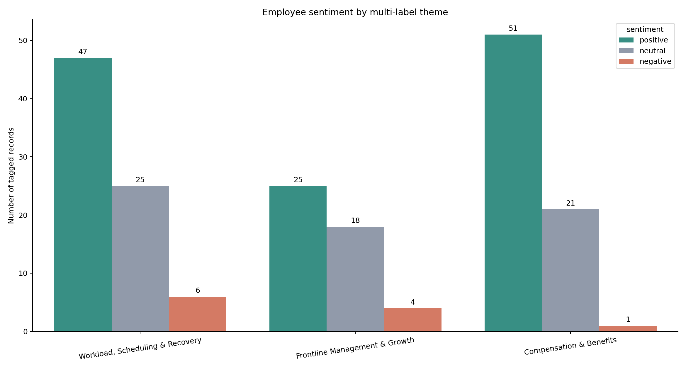

# Amazon Fulfillment Center Employee Experience Analysis

An end-to-end project that turns public, unstructured employee feedback into a focused operational recommendation.

The project follows a complete product and analytics workflow:

`public feedback → text cleaning → keyword and sentiment analysis → multi-label themes → root-cause framing → pilot recommendation`

> **Project note:** This project is based on a small sample of publicly available, anonymized material. It is not affiliated with, commissioned by, or endorsed by Amazon, Glassdoor, or YouTube. Raw reviews and transcripts are intentionally excluded from this repository.

## Executive summary

The analysis combined 139 public Glassdoor records and five public YouTube records about fulfillment-center work. The sample is not representative of Amazon's workforce, so the findings should be treated as directional hypotheses rather than company-wide conclusions.

Three themes emerged from a transparent keyword-based, multi-label taxonomy:

| Theme | Tagged records | Positive | Neutral | Negative |
|---|---:|---:|---:|---:|
| Workload, Scheduling & Recovery | 78 | 47 | 25 | 6 |
| Frontline Management & Growth | 47 | 25 | 18 | 4 |
| Compensation & Benefits | 73 | 51 | 21 | 1 |

Compensation and benefits produced the clearest positive signal. Workload, scheduling, and recovery had the largest volume and the highest negative count, making it the best candidate for a small, testable intervention.

## Recommendation

Run a four-week **Recovery Checkpoint Pilot** for one shift or operating area. The intervention adds a short, manager-led checkpoint at the beginning and midpoint of each shift to identify workload pressure, clarify break coverage, and surface recovery barriers before they compound.

The recommendation is deliberately small and reversible. It should be evaluated before any wider rollout using:

- checkpoint completion rate;
- missed or delayed break rate;
- weekly pulse score for workload manageability;
- unplanned absence rate;
- productivity and safety guardrails.

See [the intervention brief](docs/intervention-brief.md) and [the five-slide executive narrative](docs/executive-pitch.md).

## Visual findings



The YouTube sample contains only five records, so the cross-platform comparison is descriptive rather than inferential.



Theme counts are multi-label: one record may contribute to more than one theme.

## Repository structure

```text
.
├── data/
│   ├── aggregate-sentiment-by-platform.csv
│   ├── theme-sentiment-counts.csv
│   └── top-keywords.csv
├── docs/
│   ├── executive-pitch.md
│   ├── intervention-brief.md
│   └── methodology.md
├── src/
│   ├── analyze_feedback.py
│   └── generate_visuals.py
├── visuals/
│   ├── sentiment-by-theme.png
│   └── sentiment-comparison.png
├── requirements.txt
└── LICENSE
```

## Reproduce the analysis

Raw source text is not distributed. To run the pipeline with data you are authorized to use, create a CSV containing a `text` column and optionally a `platform` column.

```powershell
python -m venv .venv
.venv\Scripts\Activate.ps1
pip install -r requirements.txt
python src/analyze_feedback.py path\to\authorized_feedback.csv --output-dir output
python src/generate_visuals.py
```

The analysis script removes URLs and obvious contact details, produces polarity labels, applies the published theme dictionary, and exports aggregate-only results.

## Project methods

- Python, pandas, regular expressions and scikit-learn
- text cleaning, n-gram analysis and sentiment classification
- transparent multi-label thematic coding
- responsible handling of public review data
- hypothesis-led problem framing
- pilot design, success metrics and executive communication

## Limitations

- Public reviews are self-selected and may overrepresent unusually positive or negative experiences.
- The sample is small and uneven across platforms.
- Lexicon-based sentiment can miss sarcasm, context and mixed opinions.
- Keyword rules improve interpretability but may miss implicit themes.
- The recommendation is a hypothesis that requires operational validation and employee consultation.

## Responsible-use notes

- No raw review or transcript text is committed.
- No individual employee is identified or profiled.
- Published outputs are aggregate statistics only.
- The project should not be used for employment decisions about individuals.
